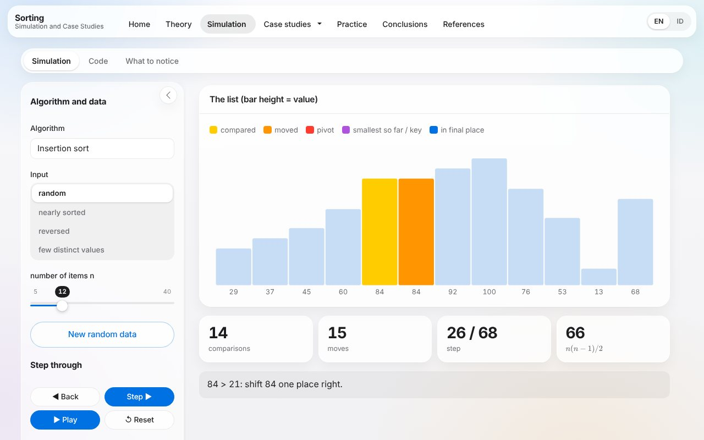

# Introduction to Data Structure and Algorithm — Course Materials

Interactive learning dashboards for **Introduction to Data Structure and Algorithm** (*Pengantar Struktur Data dan Algoritma*), taught by **Novri Suhermi** at the Department of Statistics, Institut Teknologi Sepuluh Nopember (ITS), Surabaya, Indonesia.

Each dashboard turns an algorithm into something you can watch, step through and experiment with, and connects it to the statistics you use every day.



---

## 🖥️ Interactive Dashboards

| Dashboard | What you can explore |
|---|---|
| [**Recursion: Simulation & Case Studies**](apps/recursion-simulation/) | Watch the call stack grow and shrink, see why naive Fibonacci explodes and how memoization fixes it, solve the Towers of Hanoi, and use recursion for real statistics. |
| [**Sorting: Simulation & Case Studies**](apps/sorting-simulation/) | Run six algorithms step by step on your own data, race them against each other, check which ones are stable, and see how sorting powers quantiles, boxplots, rank correlation and robust statistics. |
| [**Searching: Simulation & Case Studies**](apps/searching-simulation/) | Race linear search against binary search, play the guessing game, handle duplicates with lower and upper bounds, try smarter guesses, and see how ECDFs, random sampling and grade bands are all searches. |

Every dashboard is a **single HTML file** that runs **offline** in any modern browser, in **English or Bahasa Indonesia**.

🌐 **Try them online:**

- Recursion dashboard: **https://novrisuhermi-recursion.share.connect.posit.cloud**
- Sorting dashboard: **https://novrisuhermi-sorting.share.connect.posit.cloud**
- Searching dashboard: **https://novrisuhermi-searching.share.connect.posit.cloud**

## 🚀 Quick Start

**Online:** open one of the links above in your browser. Nothing to install.

**Offline:**

1. Open the folder of a dashboard (links in the table above).
2. Click the `.html` file, then the **Download raw file** button.
3. Open the downloaded file in your browser (Chrome, Edge, Firefox, Safari). No installation or internet connection is needed.

## 🧩 What Every Dashboard Contains

| Page | Content |
|---|---|
| **Home** | Overview, shortcuts to every simulation and case study, and how to use the dashboard |
| **Theory** | One tab per algorithm: the idea, numbered steps, a worked example, the cost, and line-numbered pseudocode |
| **Simulation** | Step-by-step simulations with Step / Play / Back / Reset and a speed slider; each has **Code** and **What to notice** sub-tabs |
| **Case studies** | Statistics applications of the algorithms |
| **Practice** | 10 multiple-choice questions with explanations |
| **Conclusions** and **References** | Key take-aways and the textbooks and sources used |

## 🧭 Learning Path

1. **Recursion**: base case, call stack, recurrences, divide and conquer, memoization
2. **Sorting**: simple sorts, merge sort and quick sort, the n log n lower bound, stability, radix sort
3. **Searching**: linear and binary search, lower and upper bounds, interpolation and exponential search

## 🗂️ Repository Structure

```
data-structure/
├── apps/                          # Interactive dashboards (one folder each)
│   ├── recursion-simulation/      # Recursion: simulation & case studies (HTML)
│   ├── sorting-simulation/        # Sorting: simulation & case studies (HTML)
│   └── searching-simulation/      # Searching: simulation & case studies (HTML)
└── README.md
```

Each app folder contains the dashboard (`.html`), its own `README.md`, and a `screenshots/` folder.

## 🇮🇩 Panduan Singkat (Bahasa Indonesia)

Repositori ini berisi dashboard pembelajaran interaktif untuk mata kuliah **Pengantar Struktur Data dan Algoritma**.

Dashboard dapat langsung dibuka secara **online**:

- Recursion: **https://novrisuhermi-recursion.share.connect.posit.cloud**
- Sorting: **https://novrisuhermi-sorting.share.connect.posit.cloud**
- Searching: **https://novrisuhermi-searching.share.connect.posit.cloud**

Untuk memakainya secara **offline**:

1. Buka folder dashboard yang diinginkan (Recursion, Sorting, atau Searching) melalui tautan pada tabel di atas.
2. Klik file `.html`, lalu tombol **Download raw file**.
3. Buka file yang terunduh dengan browser. Tidak perlu instalasi maupun internet.

Klik tombol **ID** di pojok kanan atas dashboard untuk tampilan Bahasa Indonesia.

Setiap dashboard berisi **Teori** (penjelasan dan pseudocode setiap algoritma), **Simulasi** langkah demi langkah, **Studi kasus** statistika, dan **Latihan** soal beserta pembahasannya.

## 👤 Author

**Novri Suhermi** — Department of Statistics, Institut Teknologi Sepuluh Nopember (ITS), Surabaya.

Found a mistake or have a suggestion? Please open an [issue](https://github.com/novrisuhermi/data-structure/issues).
