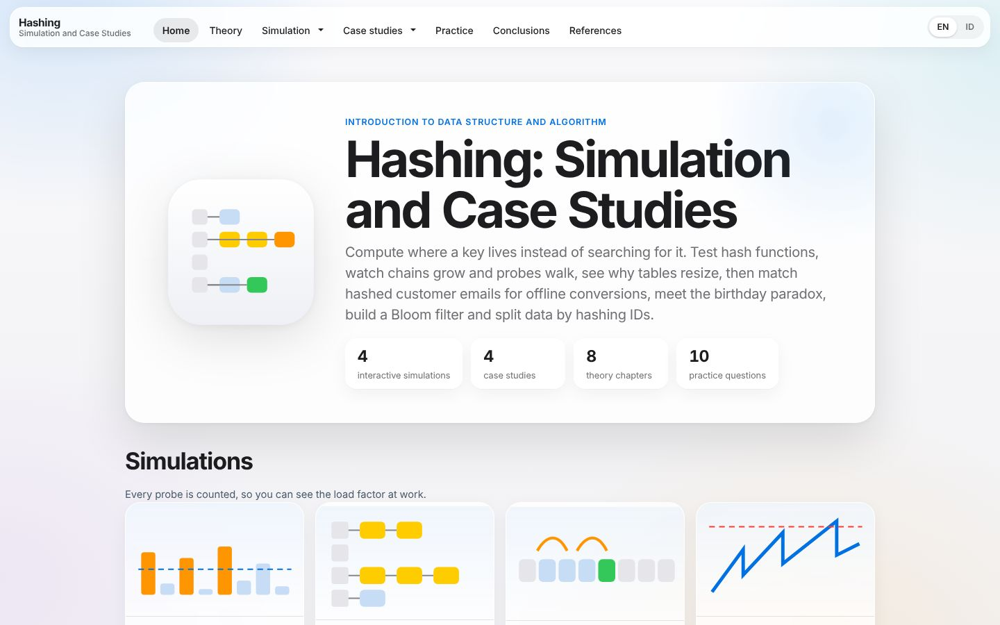
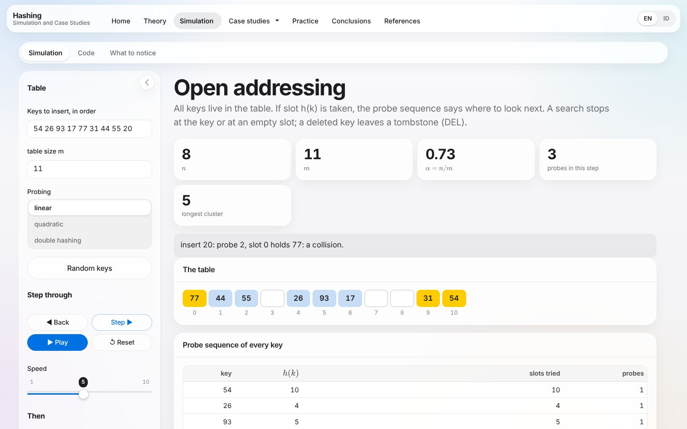
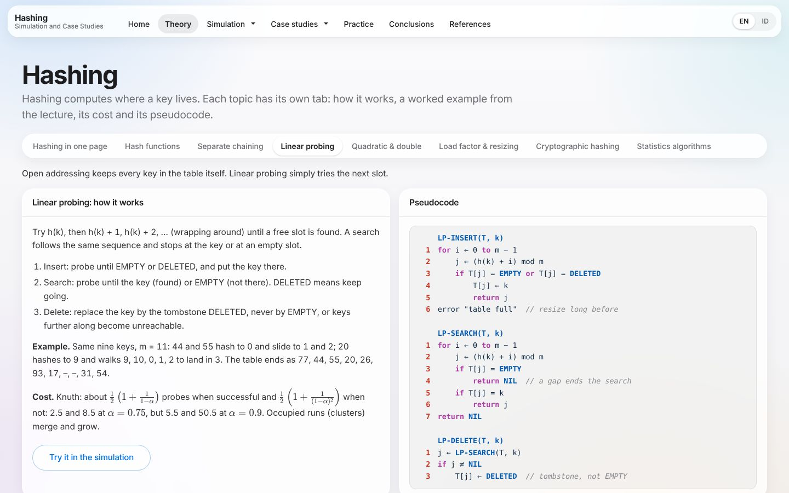

# Hashing: Simulation & Case Studies

An interactive, self-contained HTML dashboard for learning hashing: test hash functions, watch separate chaining and open addressing step by step, see why tables resize, then match hashed customer emails for offline conversions, meet the birthday paradox, build a Bloom filter and split data by hashing IDs.

🌐 **Try it online:** **https://novrisuhermi.github.io/apps/hashing/**

## Features

- **Theory** with one tab per algorithm: the idea, numbered steps, a worked example, the cost, and line-numbered pseudocode
- **Simulations** with Step, Play, Back and Reset buttons, a speed slider, and a message that explains every step
- **Code** (Python) and **What to notice** sub-tabs next to every simulation
- **Case studies** that connect the algorithms with statistics
- **Practice**: 10 multiple-choice questions with an explanation for every answer
- **English and Bahasa Indonesia**: switch with the EN / ID button in the top-right corner
- **Offline and self-contained**: one HTML file, no installation, no internet connection

## How to Use

### Online

Open the dashboard directly in your browser: **https://novrisuhermi.github.io/apps/hashing/**

### Offline

1. Download [`Hashing_Simulation_Case_Studies.html`](Hashing_Simulation_Case_Studies.html) (click the file, then the **Download raw file** button).
2. Open it in any modern web browser (Chrome, Edge, Firefox, Safari).

No installation, Python, or internet connection is required.

### Inside the dashboard

1. **Theory**: read the tab of an algorithm. The **Try it in the simulation** button opens the matching simulation.
2. **Simulation**: set the inputs in the panel on the left, then press **Step ▶** to move one step or **▶ Play** to run. Read the message under the picture at every step.
3. **Code** and **What to notice**: the Python code of the simulation, and the points to look for.
4. **Case studies**: apply the algorithm to a statistics problem.
5. **Practice**: test yourself; every answer comes with an explanation.

On a phone, tap the small arrow button at the top of a simulation to open its settings panel.

## What's Inside

### Theory

| Tab | Content |
|---|---|
| Hashing in one page | Hash tables, the load factor, and how hashing compares with linear and binary search |
| Hash functions | Division, multiplication and polynomial (Horner) string hashes |
| Separate chaining | Insert, search and delete with one list per slot |
| Linear probing | Probe sequences, clustering, tombstones and Knuth's formulas |
| Quadratic & double | Other probe sequences, and why the table size should be prime |
| Load factor & resizing | Doubling, amortised O(1) inserts, and what Python's dict does |
| Cryptographic hashing | SHA-256 matching of hashed emails, password storage and leak checks |
| Statistics algorithms | The birthday paradox, Bloom filters, stable sampling and group-by |

### Simulations

| Simulation | What you can do | What to notice |
|---|---|---|
| **Hash function explorer** | Hash numbers, user names or anagrams with four hash functions and any table size; a chi-square test checks how evenly the keys spread. | Keys 10, 20, 30, … with m = 10 all land in one slot; a prime m spreads them. |
| **Separate chaining** | Insert keys step by step, then search for or delete a key in its chain. | A search compares the key only with its own chain: about α keys. |
| **Open addressing** | Linear probing, quadratic probing and double hashing with every probe shown, tombstones for deletion, and the probe sequence of every key. | Linear probing builds clusters; quadratic probing can fail although free slots remain. |
| **Load factor and resizing** | Measured probes per search against Knuth's formulas for three methods, and a table that doubles at a chosen threshold. | Linear probing explodes near a full table; doubling keeps inserts O(1) amortised. |

### Case studies

| Case study | Content |
|---|---|
| **Offline conversions** | Match an advertiser's SPK emails with Meta's users through SHA-256 hashes, with and without normalising, then try to reverse a hashed phone number by brute force. |
| **The birthday paradox** | Exact and simulated collision probabilities: why collisions appear long before a table is full. |
| **Bloom filter** | Add items, query words, and compare the false-positive rate with the formula and the best number of hash functions. |
| **Stable train/test split** | Split students by the SHA-256 of their ID and see that new data never move old students, unlike a fresh random shuffle. |

## Screenshots

| Open addressing | Theory: Linear probing |
|---|---|
|  |  |

## 🇮🇩 Panduan Singkat (Bahasa Indonesia)

1. Buka dashboard secara **online** di **https://novrisuhermi.github.io/apps/hashing/**. Untuk memakainya **offline**, unduh file [`Hashing_Simulation_Case_Studies.html`](Hashing_Simulation_Case_Studies.html) (klik file, lalu tombol **Download raw file**), kemudian buka dengan browser (Chrome, Edge, Firefox, atau Safari); tidak perlu instalasi atau koneksi internet.
2. Klik tombol **ID** di pojok kanan atas untuk menampilkan dashboard dalam Bahasa Indonesia.
3. Mulai dari **Teori**: setiap algoritma punya tab berisi ide, langkah kerja, contoh berhitung, biaya, dan pseudocode. Tombol **Coba di simulasi** langsung membuka simulasinya.
4. Di **Simulasi**, atur input di panel kiri, lalu tekan **Langkah ▶** atau **▶ Putar**. Baca pesan di bawah gambar pada setiap langkah.
5. Sub-tab **Kode** berisi kode Python, dan **Yang perlu diperhatikan** berisi poin-poin penting.
6. **Studi kasus** menghubungkan algoritma dengan statistika, dan **Latihan** berisi 10 soal pilihan ganda beserta pembahasannya.

Di HP, ketuk tombol panah kecil di bagian atas simulasi untuk membuka panel pengaturan.

---

Part of the [Introduction to Data Structure and Algorithm](../../) course materials · Department of Statistics, Institut Teknologi Sepuluh Nopember (ITS), Surabaya.
