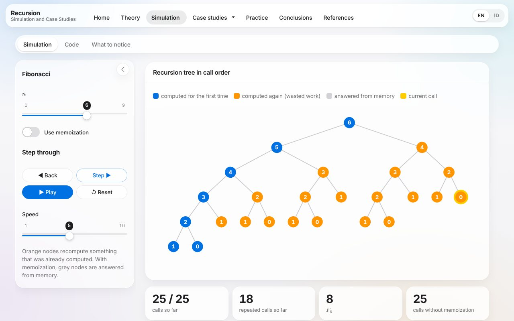
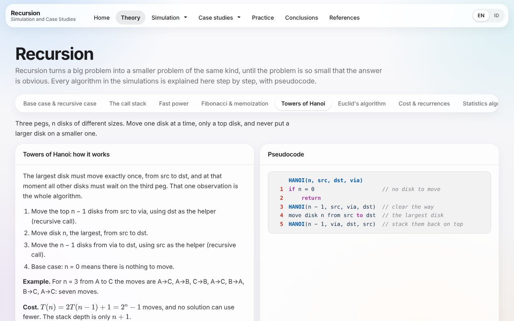

# Recursion: Simulation & Case Studies

An interactive, self-contained HTML dashboard for learning recursion: watch the call stack grow and shrink, see why naive Fibonacci explodes and how memoization fixes it, solve the Towers of Hanoi, and use recursion for real statistics.

## Features

- **Theory** with one tab per algorithm: the idea, numbered steps, a worked example, the cost, and line-numbered pseudocode
- **Simulations** with Step, Play, Back and Reset buttons, a speed slider, and a message that explains every step
- **Code** (Python) and **What to notice** sub-tabs next to every simulation
- **Case studies** that connect the algorithms with statistics
- **Practice**: 10 multiple-choice questions with an explanation for every answer
- **English and Bahasa Indonesia**: switch with the EN / ID button in the top-right corner
- **Offline and self-contained**: one HTML file, no installation, no internet connection

## How to Use

### Offline

1. Download [`Recursion_Simulation_Case_Studies.html`](Recursion_Simulation_Case_Studies.html) (click the file, then the **Download raw file** button).
2. Open it in any modern web browser (Chrome, Edge, Firefox, Safari).

No installation, Python, or internet connection is required.

### Inside the dashboard

1. **Theory**: read the tab of an algorithm. The **Try it in the simulation** button opens the matching simulation.
2. **Simulation**: set the inputs in the panel on the left, then press **Step ▶** to move one step or **▶ Play** to run. Read the message under the picture at every step.
3. **Code** and **What to notice**: the Python code of the simulation, and the points to look for.
4. **Case studies**: apply the algorithm to a statistics problem.
5. **Practice**: test yourself; every answer comes with an explanation.

On a phone, tap the small arrow button at the top of a simulation to open its settings panel.

## What's Inside

### Theory

| Tab | Content |
|---|---|
| Base case & recursive case | Factorial and the sum 0 + 1 + … + n: the two parts every recursive function needs |
| The call stack | Frames, depth, and Python's recursion limit |
| Fast power | Computing bⁿ with about log₂ n calls by halving the exponent |
| Fibonacci & memoization | Why the naive version needs millions of calls, and how a memo reduces it to 2n − 1 |
| Towers of Hanoi | The three-step recursive plan and its 2ⁿ − 1 moves |
| Euclid's algorithm | gcd(a, b) = gcd(b, a mod b) and Lamé's bound |
| Cost & recurrences | Reading the running time from a recurrence |
| Statistics algorithms | Welford's running variance, quantiles by bisection, binomial coefficients with Pascal's rule |

### Simulations

| Simulation | What you can do | What to notice |
|---|---|---|
| **The call stack** | Choose `fact(n)`, `total(n)` or `power(b, n)` and step through every call and return. | Waiting frames, the current depth, and why `power` needs far fewer frames. |
| **Fibonacci recursion tree** | Draw the tree for n up to 9, switch memoization on and off, compare call counts for n = 1 to 30. | Orange nodes repeat work that was already done; grey nodes are answered from memory. |
| **Towers of Hanoi** | Solve the puzzle with 1 to 7 disks, one move at a time, with the full move list. | The smallest disk moves every second step; the total is 2ⁿ − 1. |
| **Euclid's algorithm** | Enter any two whole numbers and follow the recursive calls and the square tiling. | The second argument shrinks fast: at most about five steps per digit. |

### Case studies

| Case study | Content |
|---|---|
| **Running mean and variance** | Welford's recursive update on exam scores, random normal data, and data shifted by 10⁹, where the textbook shortcut formula fails. |
| **Quantiles by bisection** | Find a quantile of the normal, exponential or logistic distribution by halving an interval, with every recursive call listed. |
| **Binomial coefficients** | Pascal's triangle, calls with and without memoization, and the binomial distribution. |

## Screenshots

| Fibonacci recursion tree | Theory: Towers of Hanoi |
|---|---|
|  |  |

## 🇮🇩 Panduan Singkat (Bahasa Indonesia)

1. **Unduh** file [`Recursion_Simulation_Case_Studies.html`](Recursion_Simulation_Case_Studies.html) (klik file, lalu tombol **Download raw file**), kemudian buka dengan browser (Chrome, Edge, Firefox, atau Safari). Tidak perlu instalasi atau koneksi internet.
2. Klik tombol **ID** di pojok kanan atas untuk menampilkan dashboard dalam Bahasa Indonesia.
3. Mulai dari **Teori**: setiap algoritma punya tab berisi ide, langkah kerja, contoh berhitung, biaya, dan pseudocode. Tombol **Coba di simulasi** langsung membuka simulasinya.
4. Di **Simulasi**, atur input di panel kiri, lalu tekan **Langkah ▶** atau **▶ Putar**. Baca pesan di bawah gambar pada setiap langkah.
5. Sub-tab **Kode** berisi kode Python, dan **Yang perlu diperhatikan** berisi poin-poin penting.
6. **Studi kasus** menghubungkan algoritma dengan statistika, dan **Latihan** berisi 10 soal pilihan ganda beserta pembahasannya.

Di HP, ketuk tombol panah kecil di bagian atas simulasi untuk membuka panel pengaturan.

---

Part of the [Introduction to Data Structure and Algorithm](../../) course materials · Department of Statistics, Institut Teknologi Sepuluh Nopember (ITS), Surabaya.
