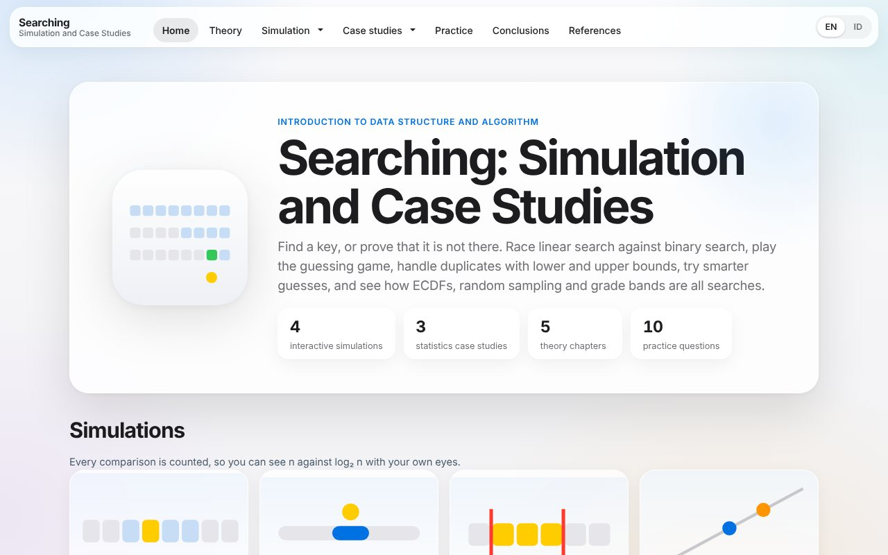
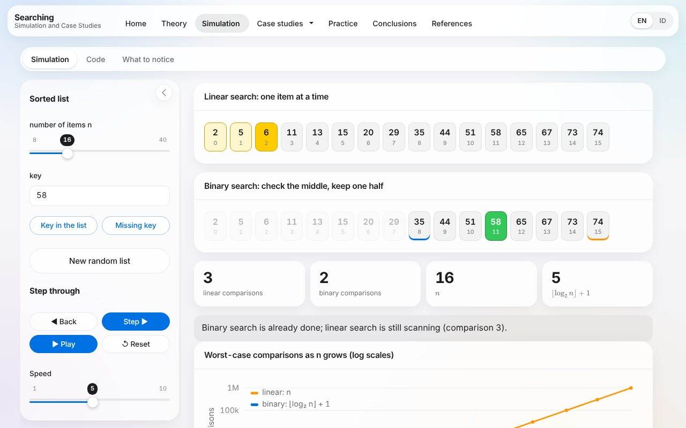
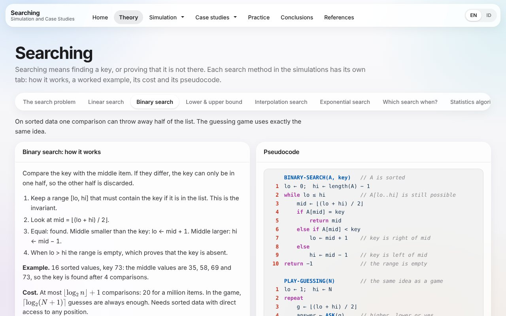

# Searching: Simulation & Case Studies

An interactive, self-contained HTML dashboard for learning searching: race linear search against binary search, play the guessing game, handle duplicates with lower and upper bounds, try smarter guesses, and see how ECDFs, random sampling and grade bands are all searches.

## Features

- **Theory** with one tab per algorithm: the idea, numbered steps, a worked example, the cost, and line-numbered pseudocode
- **Simulations** with Step, Play, Back and Reset buttons, a speed slider, and a message that explains every step
- **Code** (Python) and **What to notice** sub-tabs next to every simulation
- **Case studies** that connect the algorithms with statistics
- **Practice**: 10 multiple-choice questions with an explanation for every answer
- **English and Bahasa Indonesia**: switch with the EN / ID button in the top-right corner
- **Offline and self-contained**: one HTML file, no installation, no internet connection

## How to Use

### Offline

1. Download [`Searching_Simulation_Case_Studies.html`](Searching_Simulation_Case_Studies.html) (click the file, then the **Download raw file** button).
2. Open it in any modern web browser (Chrome, Edge, Firefox, Safari).

No installation, Python, or internet connection is required.

### Inside the dashboard

1. **Theory**: read the tab of an algorithm. The **Try it in the simulation** button opens the matching simulation.
2. **Simulation**: set the inputs in the panel on the left, then press **Step ▶** to move one step or **▶ Play** to run. Read the message under the picture at every step.
3. **Code** and **What to notice**: the Python code of the simulation, and the points to look for.
4. **Case studies**: apply the algorithm to a statistics problem.
5. **Practice**: test yourself; every answer comes with an explanation.

On a phone, tap the small arrow button at the top of a simulation to open its settings panel.

## What's Inside

### Theory

| Tab | Content |
|---|---|
| The search problem | Keys, comparisons, best, worst and average case |
| Linear search | One item at a time; works on unsorted data |
| Binary search | The invariant, the halving, and the guessing-game strategy |
| Lower & upper bound | `bisect_left`, `bisect_right`, counting in a range, binary search on the answer |
| Interpolation search | Guessing the position from the value |
| Exponential search | Doubling the step, then binary search |
| Which search when? | A comparison table, and a preview of hashing |
| Statistics algorithms | ECDF and percentile rank, sampling a category from a CDF, grade bands |

### Simulations

| Simulation | What you can do | What to notice |
|---|---|---|
| **Linear vs binary search** | Search the same sorted list with both methods side by side, for a key that is present or missing. | A missing key costs linear search n comparisons; binary search needs about log₂ n. |
| **Guess my number** | Play against the computer for numbers up to a million, then let binary search play. | ⌈log₂(N + 1)⌉ guesses are always enough: 20 for a million. |
| **Lower and upper bound** | Step through `bisect_left` and `bisect_right` on a list with duplicates and count values in a range. | For a missing key both bounds give the same position. |
| **Interpolation and exponential search** | Compare the probes of three methods on evenly spread data, skewed data and data with one huge outlier. | Interpolation search is excellent on evenly spread data and poor with an outlier. |

### Case studies

| Case study | Content |
|---|---|
| **ECDF and percentile ranks** | Each ECDF value or percentile rank is one binary search in the sorted data. |
| **Sampling from a CDF** | Inverse transform sampling of a category, the way NumPy's `choice()` does it. |
| **Grade bands** | Turn scores into letter grades with `bisect_right`, and see why the boundary rule matters. |

## Screenshots

| Linear vs binary search | Theory: Binary search |
|---|---|
|  |  |

## 🇮🇩 Panduan Singkat (Bahasa Indonesia)

1. **Unduh** file [`Searching_Simulation_Case_Studies.html`](Searching_Simulation_Case_Studies.html) (klik file, lalu tombol **Download raw file**), kemudian buka dengan browser (Chrome, Edge, Firefox, atau Safari). Tidak perlu instalasi atau koneksi internet.
2. Klik tombol **ID** di pojok kanan atas untuk menampilkan dashboard dalam Bahasa Indonesia.
3. Mulai dari **Teori**: setiap algoritma punya tab berisi ide, langkah kerja, contoh berhitung, biaya, dan pseudocode. Tombol **Coba di simulasi** langsung membuka simulasinya.
4. Di **Simulasi**, atur input di panel kiri, lalu tekan **Langkah ▶** atau **▶ Putar**. Baca pesan di bawah gambar pada setiap langkah.
5. Sub-tab **Kode** berisi kode Python, dan **Yang perlu diperhatikan** berisi poin-poin penting.
6. **Studi kasus** menghubungkan algoritma dengan statistika, dan **Latihan** berisi 10 soal pilihan ganda beserta pembahasannya.

Di HP, ketuk tombol panah kecil di bagian atas simulasi untuk membuka panel pengaturan.

---

Part of the [Introduction to Data Structure and Algorithm](../../) course materials · Department of Statistics, Institut Teknologi Sepuluh Nopember (ITS), Surabaya.
