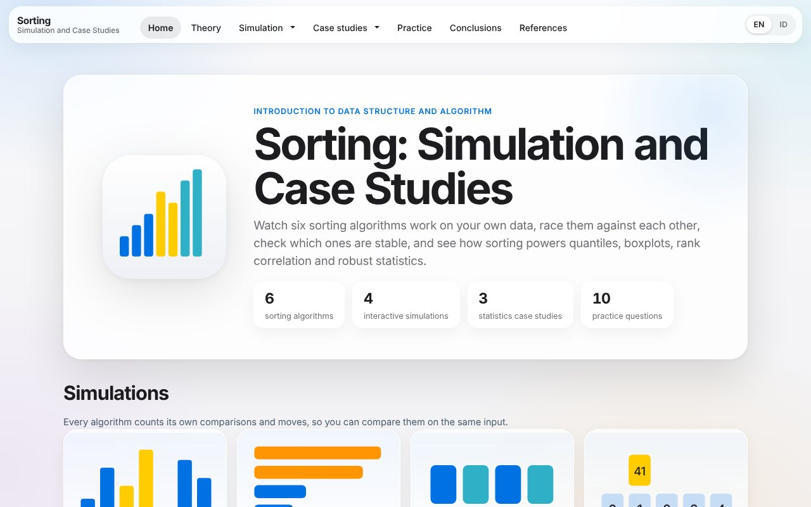
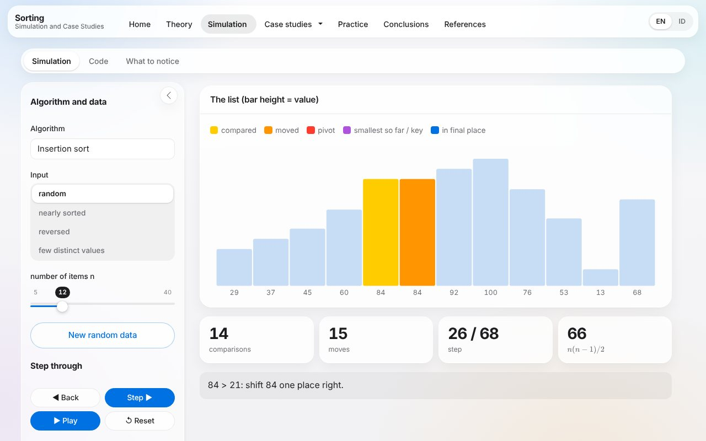
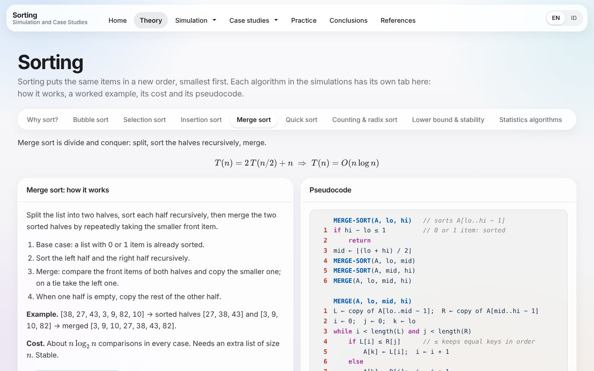

# Sorting: Simulation & Case Studies

An interactive, self-contained HTML dashboard for learning sorting algorithms: run six algorithms step by step on your own data, race them against each other, check which ones are stable, and see how sorting powers quantiles, boxplots, rank correlation and robust statistics.

🌐 **Try it online:** **https://novrisuhermi-sorting.share.connect.posit.cloud**

## Features

- **Theory** with one tab per algorithm: the idea, numbered steps, a worked example, the cost, and line-numbered pseudocode
- **Simulations** with Step, Play, Back and Reset buttons, a speed slider, and a message that explains every step
- **Code** (Python) and **What to notice** sub-tabs next to every simulation
- **Case studies** that connect the algorithms with statistics
- **Practice**: 10 multiple-choice questions with an explanation for every answer
- **English and Bahasa Indonesia**: switch with the EN / ID button in the top-right corner
- **Offline and self-contained**: one HTML file, no installation, no internet connection

## How to Use

### Online

Open the dashboard directly in your browser: **https://novrisuhermi-sorting.share.connect.posit.cloud**

### Offline

1. Download [`Sorting_Simulation_Case_Studies.html`](Sorting_Simulation_Case_Studies.html) (click the file, then the **Download raw file** button).
2. Open it in any modern web browser (Chrome, Edge, Firefox, Safari).

No installation, Python, or internet connection is required.

### Inside the dashboard

1. **Theory**: read the tab of an algorithm. The **Try it in the simulation** button opens the matching simulation.
2. **Simulation**: set the inputs in the panel on the left, then press **Step ▶** to move one step or **▶ Play** to run. Read the message under the picture at every step.
3. **Code** and **What to notice**: the Python code of the simulation, and the points to look for.
4. **Case studies**: apply the algorithm to a statistics problem.
5. **Practice**: test yourself; every answer comes with an explanation.

On a phone, tap the small arrow button at the top of a simulation to open its settings panel.

## What's Inside

### Theory

| Tab | Content |
|---|---|
| Why sort? | Order statistics, and why we count comparisons |
| Bubble sort | Swap neighbours; early stop when a pass makes no swap |
| Selection sort | Pick the smallest remaining value each time |
| Insertion sort | Slide each value into the sorted part, like sorting cards |
| Merge sort | Divide and conquer, with the MERGE step |
| Quick sort | Lomuto partition, last-item pivot and random pivot |
| Counting & radix sort | Sorting without comparisons |
| Lower bound & stability | Why about n log₂ n comparisons are unavoidable; stable sorts and Python's `sorted()` |
| Statistics algorithms | Sample quantiles, median and trimmed mean, Spearman's ρ and Kendall's τ by counting inversions |

### Simulations

| Simulation | What you can do | What to notice |
|---|---|---|
| **Sorting visualizer** | Run bubble, selection, insertion, merge or quick sort (last-item or random pivot) on random, nearly sorted, reversed or few-distinct-value data, one comparison at a time. | Insertion sort on nearly sorted data, and quick sort's worst case on sorted data. |
| **Algorithm race** | Count the comparisons of every algorithm on the same list, for n up to 2,000, with log-scale charts. | Slopes of 2 against slopes of about 1 on the log–log plot: n² against n log n. |
| **Stability lab** | Sort ten students by grade and see whether students with the same grade keep their order. | Selection and quick sort can swap equal keys; insertion and merge sort never do. |
| **Radix sort** | Sort your own numbers digit by digit with ten pockets. | Each pass must be stable, and no comparison is ever made. |

### Case studies

| Case study | Content |
|---|---|
| **Quantiles and the boxplot** | All nine Hyndman–Fan quantile rules (type 7 is the R and NumPy default) on your data, with a boxplot. |
| **Rank correlation** | Spearman's ρ from ranks and Kendall's τ by counting inversions with merge sort. |
| **Robust summaries** | Move one outlier and compare the mean, the median and trimmed means. |

## Screenshots

| Sorting visualizer | Theory: Merge sort |
|---|---|
|  |  |

## 🇮🇩 Panduan Singkat (Bahasa Indonesia)

1. Buka dashboard secara **online** di **https://novrisuhermi-sorting.share.connect.posit.cloud**. Untuk memakainya **offline**, unduh file [`Sorting_Simulation_Case_Studies.html`](Sorting_Simulation_Case_Studies.html) (klik file, lalu tombol **Download raw file**), kemudian buka dengan browser (Chrome, Edge, Firefox, atau Safari); tidak perlu instalasi atau koneksi internet.
2. Klik tombol **ID** di pojok kanan atas untuk menampilkan dashboard dalam Bahasa Indonesia.
3. Mulai dari **Teori**: setiap algoritma punya tab berisi ide, langkah kerja, contoh berhitung, biaya, dan pseudocode. Tombol **Coba di simulasi** langsung membuka simulasinya.
4. Di **Simulasi**, atur input di panel kiri, lalu tekan **Langkah ▶** atau **▶ Putar**. Baca pesan di bawah gambar pada setiap langkah.
5. Sub-tab **Kode** berisi kode Python, dan **Yang perlu diperhatikan** berisi poin-poin penting.
6. **Studi kasus** menghubungkan algoritma dengan statistika, dan **Latihan** berisi 10 soal pilihan ganda beserta pembahasannya.

Di HP, ketuk tombol panah kecil di bagian atas simulasi untuk membuka panel pengaturan.

---

Part of the [Introduction to Data Structure and Algorithm](../../) course materials · Department of Statistics, Institut Teknologi Sepuluh Nopember (ITS), Surabaya.
